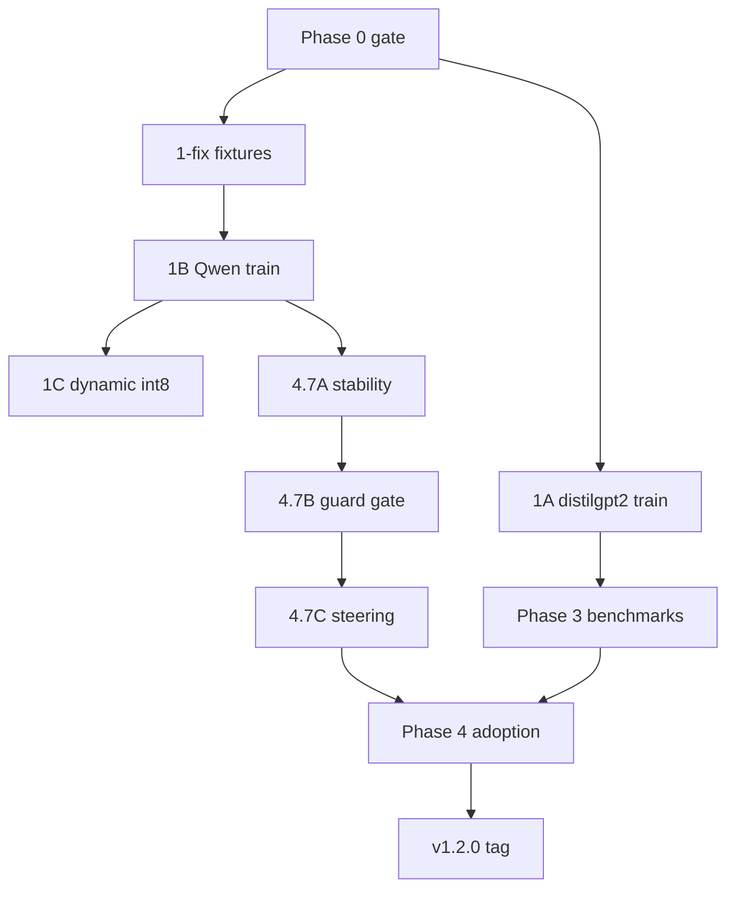

# Commit phase map (v1.2 build)

Systematic build order with **one logical commit per phase**. Probe weights (`*.pt`) stay gitignored — commit **meta.json**, manifests, code, fixtures, and docs only. Upload weights via GitHub Release when tagging.

## Branch strategy

| Branch | Purpose |
|--------|---------|
| `main` | Stable; merge after each phase passes pytest |
| `build/v1.2-poc` | Optional integration branch for full v1.2 stack |

## Phase → commit map

| Phase | Commit when done | Files typically changed | Message template |
|-------|------------------|-------------------------|------------------|
| **0** Gate | pytest green, no code change | — | *(no commit unless fixing failures)* |
| **1-fix** | POC demo fixtures | `benchmarks/fixtures/poc_emotional_prompts.json` | `bench: add POC emotional prompt fixture for intervention demo` |
| **1B** | Qwen probe trained | `probes/zoo/qwen2_5_0_5b_instruct_text.meta.json`, `benchmarks/reports/latest_qwen*_manifest.json` | `train: Qwen2.5-0.5B text probe meta + benchmark manifest` |
| **1A** | distilgpt2 retrained | `probes/zoo/distilgpt2_text.meta.json`, `distilgpt2_narratives_pca.meta.json`, `latest_distilgpt2_manifest.json` | `train: refresh distilgpt2 text/brain probe meta and benchmarks` |
| **1C** | CPU int8 load | `core/extractor.py`, `tests/test_quantized_load.py`, `docs/TRAIN_ON_YOUR_MACHINE.md` | `feat: ANIMA_LOAD_DYNAMIC_INT8 for CPU quantized inference` |
| **4.7A** | Stability monitor | `core/stability.py`, `api/server.py`, `api/schemas.py`, `probes/guard_config.yaml`, `tests/test_stability.py`, dashboard components | `feat: rolling readout stability score in API and dashboard` |
| **4.7B** | Guard gate | `core/guard.py`, `api/schemas.py`, `api/server.py`, `tests/test_guard_gate.py`, dashboard | `feat: guard_mode gate suppresses labels in unstable windows` |
| **4.7C** | Active steering | `core/extractor.py`, `probes/validate.py`, `cli/run.py`, `tests/test_intervention.py`, `docs/USAGE_AND_LIMITATIONS.md` | `feat: opt-in intervention_mode dampen steering during generation` |
| **3** | Benchmark hardening | `benchmarks/fixtures/*`, `benchmarks/manifest.py`, `.github/workflows/ci.yml` | `ci: expand guard fixtures and benchmark-smoke on push` |
| **4** | Adoption | `dashboard/*`, `scripts/gradio_demo.py`, `docs/GETTING_STARTED.md`, `README.md` | `feat: dashboard model selector and v1.2 demo docs` |
| **1b** | Release v1.1.1 | `scripts/download_zoo.py`, `probes/zoo/README.md` | `release: v1.1.1 zoo download list for Qwen/TinyLlama` |

## Execution order (dependencies)

**Parallel tracks after Phase 0:**
- **Critical path (demo):** 1-fix → 1B → 1C → 4.7A → 4.7B → 4.7C → 4
- **Benchmark path:** 1A → 3 → 4 (README tables)

## Per-commit checklist

1. `python -m pytest -q -k "not distilgpt2"` (or full suite if phase touches distilgpt2)
2. No absolute Windows paths in committed JSON manifests
3. No `*.pt` / secrets in staging (`git status`)
4. Update `benchmarks/reports/latest_*_manifest.json` alias only (not every timestamp folder)

## Tags

| Tag | After commits |
|-----|----------------|
| **v1.1.1** | 1B + 1C + 1b (optional proxy zoo on Release) |
| **v1.2.0** | All phases through 4 + 3 |
