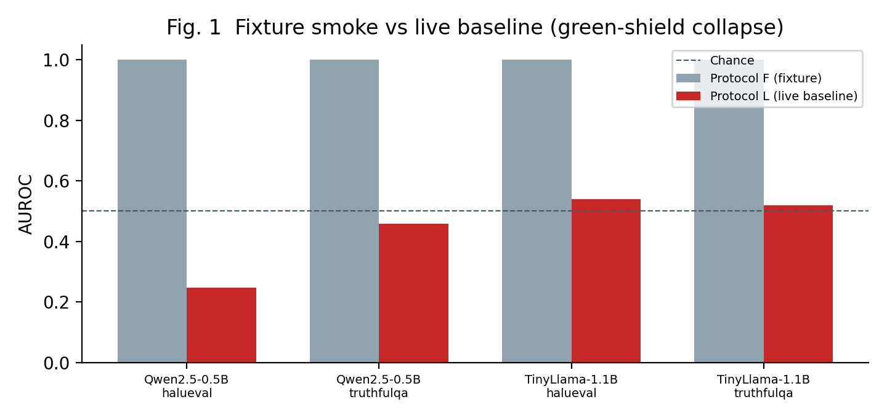
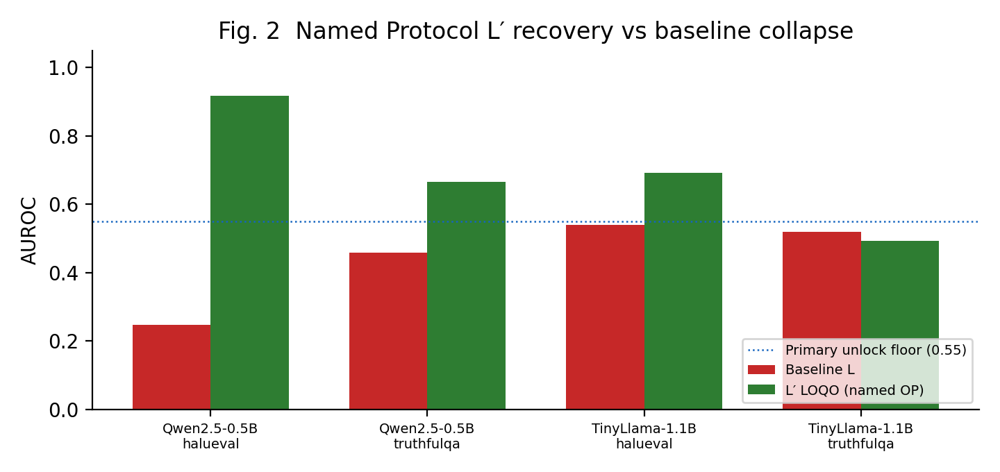
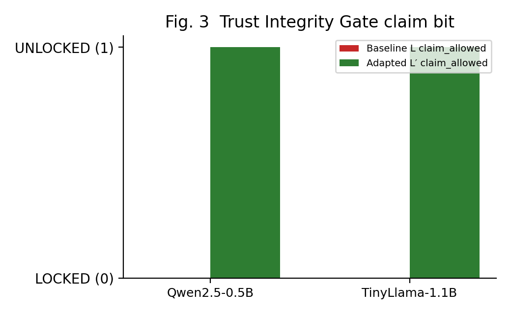
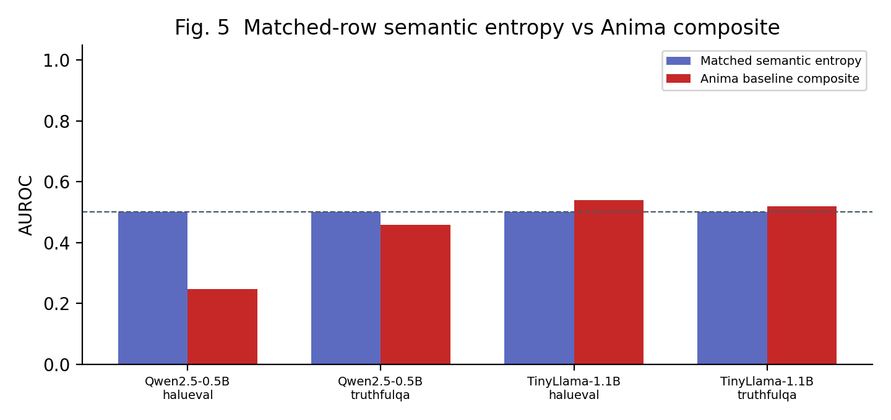
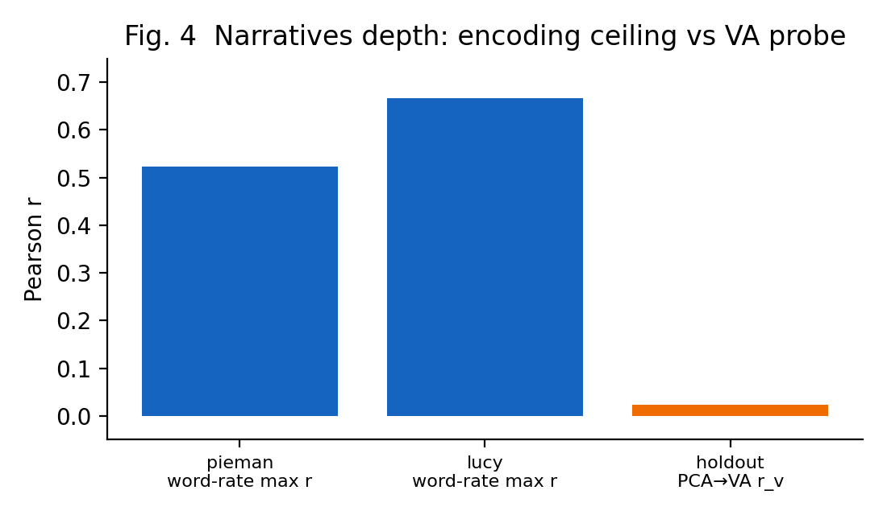

# Green Shields, Live Failures: Trust Integrity for LLM Affect Probes

**Siddarth Boggarapu**  
Independent Researcher, Bengaluru, India  
Email: siddarthb078@gmail.com  

**Draft status:** IEEE-shaped manuscript draft for internal review. Numbers match sealed receipts in `benchmarks/reports/` (lock date 2026-10-23). Not yet venue-formatted in IEEEtran PDF.

---

## Abstract

Trust interfaces for language-model tools often display green “safe” or “calibrated” badges after passing synthetic or fixture checks. We study whether such badges remain honest when the same scoring pipeline is evaluated on live claim-encode rows from public HaluEval and TruthfulQA. We introduce Anima, an open instrumentation stack that attaches valence, arousal, and uncertainty probes to Hugging Face causal language models, and a Trust Integrity Gate that seals a binary `trust_ui_claim_allowed` bit from multi-criteria live evaluation. On two locked instruction models (Qwen2.5-0.5B-Instruct and TinyLlama-1.1B-Chat), fixture Protocol F yields AUROC 1.00 while baseline Protocol L collapses (e.g., Qwen–HaluEval AUROC 0.25 with never-abstain and anti-aligned ranking), so GreenShieldBench correctly denies unlock. A separately named Protocol L′ LOQO ridge adaptation restores primary-suite AUROC (Qwen–HaluEval 0.92) and unlocks adapted receipts without silent production label flips. Matched semantic-entropy controls on the same rows do not overturn the baseline failure. A real Narratives fMRI depth check shows stimulus encoding ceilings (word-rate max *r* up to approximately 0.67) while PCA→valence holdout remains near zero—encoding interest without emotion–brain claims. Anima releases code, sealed receipts, and a dashboard that refuses green trust language without a sealed unlock.

**Index Terms**—Claim encoding, hallucination evaluation, interpretability, trust user interfaces, valence-arousal probing.

---

## I. Introduction

Product and research demos increasingly wrap language models in **trust UI**: colored badges, abstain hints, and “calibrated” meters. Fixture benchmarks and synthetic story suites can make those badges look perfect. The scientific risk is familiar: **transfer failure**—a scorer that separates labels in a toy distribution may invert, flatten, or refuse to abstain on live public rows.

This paper treats **trust-UI integrity** as an evaluation object, not a marketing skin. We ask three concrete questions:

1. Does a fixture-perfect guard/probe composite still rank live HaluEval and TruthfulQA **claim-encode** rows above chance?
2. Can a gate **refuse** green-badge language when live criteria fail, even if fixtures pass?
3. If recovery is possible, can it be published as a **named operating point** rather than a silent polarity flip in production config?

**Contributions.**

- **Anima instrumentation** — open FastAPI + React stack reading valence, arousal, and uncertainty from causal-LM hidden states, with an optional TRIBEv2 *linear sketch* for visualization (not voxel decoding).
- **Protocols F / L / R / L′** — fixture smoke, live claim-encode, threshold retune, and explicit LOQO ridge adaptation.
- **Trust Integrity Gate (TIG) + GreenShieldBench** — sealed `trust_ui_claim_allowed` bit; fixture AUROC alone cannot unlock.
- **Locked negative + recovery results** on Qwen2.5-0.5B-Instruct and TinyLlama-1.1B-Chat (Tables I–III; Figs. 1–3).
- **Encoding-only Narratives depth** clarifying what real fMRI can and cannot support for this probe stack (Fig. 4).

We **do not** claim hallucination detection state of the art, subjective model emotion, or human user-study proof of badge deception (our misleading-green metric is simulated badge replay).

---

## II. Related Work

**Uncertainty and hallucination scoring.** Semantic entropy and related sampling-based uncertainty estimates are strong baselines for free-generation settings [1]. Our Protocol L uses **claim-encode** scoring on fixed public rows so Anima’s composite can be compared without a free-gen judge loop; matched semantic entropy on the same rows is reported as a control (Fig. 5).

**Affect and probing.** Linear probes on hidden states are standard in interpretability. Anima’s text path maps GoEmotions-style labels into valence/arousal; we treat these as **constructed readouts**, not feelings.

**Trust and evaluation honesty.** REFORMS and related reporting checklists emphasize claim–evidence alignment, leakage control, and uncertainty [2]. Our gate operationalizes a product-facing consequence: **no green badge without a sealed live pass**.

**Encoding models and Narratives.** Story listening datasets such as Narratives (ds002345) support stimulus→BOLD encoding analyses [3]. We separate encoding ceilings from Anima’s PCA→valence/arousal probe, which is a different construct.

---

## III. Methods

### III-A. Anima Composite

For each token (or claim-encode pass), Anima hooks configured transformer layers, runs a small probe head, and forms a **guard composite** used for abstain recommendations (entropy-style terms, uncertainty head, optional layer-disagreement). Production thresholds live in `guard_config.yaml`. Dashboard language is subordinate to TIG.

### III-B. Evaluation Protocols

| Protocol | Definition |
|----------|------------|
| **F** | Fixture smoke (CI). AUROC may be 1.00; **not citeable** as detection. |
| **L** | Live claim-encode on locked HaluEval / TruthfulQA rows (*n*=80 per suite). Bootstrap AUROC CI with *B*=2000, seed 42. |
| **R / R′** | Threshold retune / held-out retune on locked rows (abstain accuracy). |
| **L′** | **Named** leave-one-question-out (LOQO) ridge adaptation on locked features. Separate operating point; not a silent rewrite of baseline polarity. |

**Polarity diagnostic.** Ranking is labeled `anti_aligned_ranking` only when AUROC &lt; 0.45; near-chance and aligned bands are reported separately so “flip = 1−AUROC” is not misread as anti-alignment.

### III-C. Trust Integrity Gate and GreenShieldBench

TIG aggregates live AUROC floors, transfer gap Δ(F−L), never-abstain, polarity, and related checks into `trust_ui_claim_allowed`. GreenShieldBench scores fixture→live integrity; **baseline** receipts are expected to **fail** unlock on current locks. Adapted receipts reference Protocol L′ explicitly.

**Misleading-green rate (MGR).** Simulated replay of a green badge under live failure conditions—not a human subjects study.

### III-D. Matched Semantic Entropy

On the same Protocol L questions, we score a matched semantic-entropy baseline (*K*=5 samples, seed 42) so recovery or collapse cannot be attributed to an unfair row set.

### III-E. Narratives Depth

On a laptop subset of OpenNeuro/FCP-INDI Narratives (stories *pieman*, *lucy*; three subjects), we report word-rate→BOLD encoding statistics and Anima PCA→VA holdout correlation. TRIBEv2 remains a same-activation linear sketch.

---

## IV. Experimental Setup

- **Models:** `Qwen/Qwen2.5-0.5B-Instruct`, `TinyLlama/TinyLlama-1.1B-Chat-v1.0` (locked TIG pair); `distilgpt2` for Narratives depth.
- **Suites:** HaluEval = primary unlock suite; TruthfulQA = secondary.
- **Construct:** claim-encode (not free-generation + LLM-as-judge).
- **Artifacts:** `benchmarks/reports/trust_integrity_*.json`, `protocol_l_prime_*.json`, `greenshield_bench_*.json`, `ANIMA_NUMBER_TABLE.md`.
- **Gate env:** `ANIMA_TRUST_GATE=auto` attaches sealed receipts when present; dashboard banner reads `GET /trust-badge`.

---

## V. Results

### V-A. Fixture Perfection, Live Collapse (Claim C1–C2)

Fig. 1 contrasts Protocol F vs Protocol L AUROC. Fixtures sit at 1.00; live baseline composites fall to **0.2469** (Qwen–HaluEval, 95% CI [0.144, 0.363]), **0.4587** (Qwen–TruthfulQA), **0.5387** / **0.5188** (TinyLlama). Both models **never abstain** on baseline live rows. Qwen–HaluEval is **anti_aligned_ranking**. Transfer gaps Δ(F−L) exceed the unlock budget (e.g., 0.75 on Qwen–HaluEval). Baseline TIG and GreenShieldBench are **LOCKED / fail** (Fig. 3; Table II).

**Fig. 1.** Fixture Protocol F versus live Protocol L AUROC on locked rows. Chance = 0.5. Fixture bars are smoke only.

### V-B. Named L′ Recovery (Claim C3)

Fig. 2 shows Protocol L′ LOQO AUROC: Qwen–HaluEval **0.9163** [0.850, 0.969]; TinyLlama–HaluEval **0.6919** [0.577, 0.810]. TruthfulQA remains harder (Qwen 0.6644; TinyLlama 0.4931 near chance with full abstain). Adapted TIG/GSB **pass** when primary-suite criteria are met (Fig. 3). Production `guard_config.yaml` is not silently polarity-flipped; L′ is labeled in receipts as the recovery OP.

**Fig. 2.** Baseline L versus named Protocol L′ LOQO AUROC. Dashed line: primary unlock floor 0.55.

**Fig. 3.** Sealed `trust_ui_claim_allowed` for baseline vs adapted operating points.

### V-C. Matched Semantic Entropy (Claim C4)

Fig. 5 places matched semantic entropy near 0.50 AUROC on these claim-encode rows, while Anima’s baseline composite is often *worse* than chance on Qwen–HaluEval. The point is not “Anima beats SE”; it is that **baseline trust collapse is not an artifact of omitting a standard uncertainty baseline**.

**Fig. 5.** Matched-row semantic entropy vs Anima baseline composite AUROC.

### V-D. Narratives Encoding Ceilings (Claim C5)

Fig. 4: word-rate max *r* ≈ **0.52** (pieman) and **0.67** (lucy) on the scored voxel subset; Anima PCA→valence holdout *r* ≈ **0.02**. We report encoding interest and **refuse** emotion–brain product claims.

**Fig. 4.** Narratives depth: stimulus encoding ceilings vs PCA→VA holdout.

### V-E. Summary Tables

**TABLE I**  
Protocol L baseline AUROC (claim-encode, *n*=80)

| Model | Suite | AUROC | 95% CI | Polarity |
|-------|-------|------:|--------|----------|
| Qwen2.5-0.5B | HaluEval | 0.2469 | [0.144, 0.363] | anti_aligned |
| Qwen2.5-0.5B | TruthfulQA | 0.4587 | [0.328, 0.592] | near_chance |
| TinyLlama-1.1B | HaluEval | 0.5387 | [0.415, 0.671] | near_chance |
| TinyLlama-1.1B | TruthfulQA | 0.5188 | [0.380, 0.652] | near_chance |

**TABLE II**  
Trust Integrity / GreenShieldBench

| Model | OP | claim_allowed | GSB |
|-------|----|---------------|-----|
| Qwen | Baseline L | no | fail |
| Qwen | Adapted L′ | yes | pass |
| TinyLlama | Baseline L | no | fail |
| TinyLlama | Adapted L′ | yes | pass |

**TABLE III**  
Protocol L′ LOQO AUROC (primary = HaluEval)

| Model | HaluEval | TruthfulQA |
|-------|---------:|-----------:|
| Qwen | 0.9163 | 0.6644 |
| TinyLlama | 0.6919 | 0.4931 |

Full machine table: `benchmarks/reports/ANIMA_NUMBER_TABLE.md`.

---

## VI. Discussion and Limitations

**Claim–evidence ladder.** C1–C2 are negative results with sealed baselines—the paper’s lead finding. C3 is conditional on accepting L′ as a **declared** adaptation. C4 prevents a “missing SE” rebuttal on this construct. C5 bounds neuroscience rhetoric.

**Construct limits.** Claim-encode ≠ free-generation hallucination benchmarks. MGR ≠ user study. L′ must not be described as “the default probe became truthful.”

**Scale.** Two small instruction models and *n*=80 rows prioritize lockable honesty over leaderboard scale. Larger models and free-gen judges are future work.

**fMRI.** Subset depth (two stories, three subjects) supports encoding ceilings, not atlas-level neuroscience.

---

## VII. Conclusion

Green trust badges that pass fixtures can fail live claim-encode evaluation. Anima seals that failure, exposes it in product UI, and documents a named L′ recovery path without overclaiming emotion, brain alignment, or hallucination SOTA. Code and sealed receipts accompany this draft.

---

## Appendix A — Reproducibility (REFORMS-aligned)

| Item | Location |
|------|----------|
| Locked metrics | `benchmarks/reports/*.json`, `ANIMA_NUMBER_TABLE.md` |
| Claim sheet | `docs/paper/CLAIM_SHEET.md` |
| Figure regen | `python scripts/render_paper_figures.py` |
| TIG CLI | `python -m benchmarks.run_trust_integrity_gate --all-locked` |
| Badge console | `python -m benchmarks.trust_badge_console` |
| Brain data card | `docs/BRAIN_PROBE_DATA.md` |

---

## References

[1] A. Kuhn, Y. Gal, and S. Farquhar, “Semantic Uncertainty: Linguistic Invariances for Uncertainty Estimation in Natural Language Generation,” ICLR, 2023.  
[2] S. Kapoor *et al.*, “REFORMS: Consensus-based Recommendations for Machine-learning-based Science,” *Science Advances*, 2024.  
[3] S. A. Nastase *et al.*, “The ‘Narratives’ dataset,” OpenNeuro ds002345, 2021.  
[4] J. Li *et al.*, “HaluEval,” EMNLP, 2023.  
[5] S. Lin, J. Hilton, and O. Evans, “TruthfulQA,” ACL, 2022.  
[6] D. Demszky *et al.*, “GoEmotions,” ACL, 2020.

---

*End of draft. Convert to IEEEtran with `anima_ieee_draft.tex` when venue formatting is required.*
