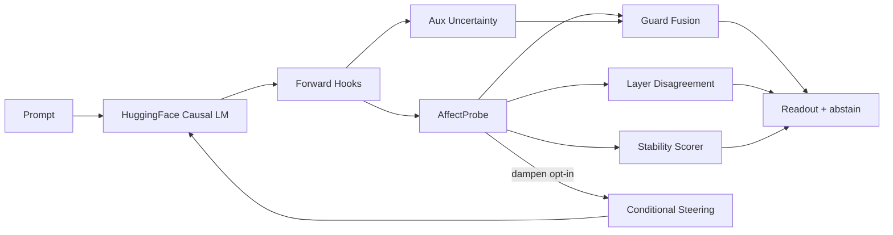

# Anima: Affect-Probed Reliability Gating for Language Model Generation

**A System Overview and Preliminary Benchmarks**

Siddarth Boggarapu  
Independent · Bangalore, India · siddarthb078@gmail.com · https://github.com/Siddarthb07/Anima

**Status:** Draft v3 (2026-07-18). Live claim-encoding guard eval + signal ablations added. Fixture AUROC 1.00 retained only as policy smoke. Chat-template alignment for instruct models landed; Qwen text-probe retrain complete (val r_v 0.398, prompt gap 0.59). Not yet submission-ready for hallucination-detection claims.

---

## Abstract

We present **Anima**, an open-source system that reads emotion-style signals — valence, arousal, and an uncertainty score — from the hidden states of causal language models during generation, using lightweight linear probes attached via forward hooks. Beyond passive readout, Anima wires these signals into a **four-mechanism integrated reliability system** operating on a shared per-token readout stream: (1) layer-disagreement detection comparing early- and late-layer probe readouts from the same head, (2) rolling-window temporal stability scoring, (3) calibrated fusion of probe uncertainty with auxiliary logits/attention signals and lexical hedging cues that triggers an abstention recommendation (guard module), and (4) optional conditional corrective steering when recent valence history shows instability. Mechanisms (1)–(2) and (4) are coordinated parallel outputs; only (3) drives the abstain bit by default. We report preliminary benchmark results across seven open-weight models (0.1B–2B parameters) on GoEmotions-derived valence/arousal prediction and a synthetic-minimal brain-alignment holdout. We are explicit about where the system falls short of a publishable reliability claim: on **live claim-encoding** evaluation (HaluEval + TruthfulQA question/answer pairs encoded through the LM; n=80 each), the default abstain thresholds **never fire** (fused max ≈0.45 ≪ 0.82), abstain accuracy collapses to chance (0.50), and fused/entropy ranking AUROC is **anti-correlated** with hallucination labels on HaluEval (composite AUROC 0.25). Probe-uncertainty alone reaches AUROC **0.66** on TruthfulQA — the only above-chance single signal in that suite. Fixture AUROC 1.00 remains a policy smoke test only. We frame this as a **systems and methodology contribution** — combining affect-style probing with a multi-signal, layer-aware gating pipeline — rather than a claim of state-of-the-art hallucination detection.

---

## 1. Introduction

Hallucination in large language models — fluent, confident output that is factually ungrounded — remains an open reliability problem. A growing line of work argues that internal model state contains signal about impending hallucination before it surfaces in text: attention divergence, layer-wise information deficiency, and probe-based confidence estimation on hidden states have each been shown to correlate with output correctness (Marks & Tegmark, 2023; Thai et al., 2025). Separately, activation steering — adding a learned direction vector to the residual stream at inference time — has been used to shift model behavior toward truthfulness without fine-tuning (Li et al., 2023; Rimsky et al., 2024).

**Anima's contribution is not a new signal in isolation.** It is a system that:

**(a)** frames the internal-state readout in **affective terms** (valence/arousal/uncertainty) rather than a raw truthfulness score, and  
**(b)** integrates **four mechanisms** — layer-disagreement detection, temporal stability estimation, calibrated multi-signal fusion (abstention), and optional conditional corrective steering — into one **real-time reliability instrumentation stack** released as an installable open-source tool with a live dashboard. Abstention is driven by the guard fusion module; layer-disagreement and stability surface as parallel signals (stability can relabel regions when `guard_mode="gate"`).

We report where this stands today, honestly: the probing and steering components work and are benchmarked; the gating pipeline's abstention logic is implemented and unit-tested; live claim-encoding eval on HaluEval/TruthfulQA (Section 5.4) shows **ranking signal in the probe-uncertainty head** but **default fused thresholds do not separate classes** and fused logits uncertainty is anti-correlated with hallucination labels on this protocol. Closing the generation-time (not claim-encoding) gap and recalibrating thresholds (Section 7) remains required before any hallucination-detection claim.

---

## 2. Related Work

### 2.1 Probing hidden states for hallucination/uncertainty

Linear and shallow classifiers on transformer hidden states predict hallucination risk or correctness, generally finding later layers more predictive for factuality-style probes (Marks & Tegmark, 2023; Thai et al., 2025; O'Neill et al., 2025). Token-level entity hallucination probes enable streaming detection during generation (Obeso & Arditi, 2025). These approaches validate **single signals** offline; Anima integrates multiple signals into a real-time policy.

### 2.2 Layer-wise internal signals

Recent work finds attention-map divergence and layer-wise information flow predictive of hallucination (INSIDE/EigenScore; Aiersilan, 2026), motivating white-box detection as an alternative to output-only uncertainty estimation such as semantic entropy (Farquhar et al., 2024). Anima's layer-disagreement module compares the **same affect probe head** on early vs late layers within one forward pass.

### 2.3 Activation steering

Inference-Time Intervention (ITI; Li et al., 2023), Contrastive Activation Addition (CAA; Rimsky et al., 2024), and Representation Engineering (RepE; Zou et al., 2023) shift activations along learned directions at inference time. These methods apply steering **unconditionally** or with manually tuned strength. Anima applies steering **conditionally** only when a valence swing exceeds threshold, within a broader gating pipeline.

### 2.4 Abstention as mechanistic intervention

**MERA** (Hedstrom et al., ICML 2025) is the closest prior art to Anima's guard design: it combines calibrated abstention with adaptive activation steering via a helper model that predicts error likelihood. Anima differs by (i) using probe-derived affect signals directly rather than a separate helper model, (ii) adding layer-disagreement and rolling stability as independent gating inputs, and (iii) framing probes in valence/arousal space rather than truthfulness classification. **Seal** (Wang et al., ACL 2025) addresses abstention via fine-tuning with a [REJ] token — a training-time approach, not inference-time gating.

### 2.5 How Anima differs (summary)

Existing work generally validates a single signal against one benchmark family. Anima integrates **four distinct mechanism types** into one calibrated fusion and gating policy, applied through an affect-probe lens, and ships it as a **real-time system** (FastAPI + WebSocket + dashboard) rather than an offline evaluation script. This is a systems/integration contribution; individual signal types are not independently novel.

---

## 3. System Description

### 3.1 Architecture



**Probe extraction.** Forward hooks attach to a configurable set of decoder layers. At each generated token, hidden states pass through `AffectProbe`: learned softmax weights fuse N layer activations, then three linear heads output valence (`tanh`, [−1,1]), arousal (`sigmoid`, [0,1]), and uncertainty (`sigmoid`, [0,1]). The same head weights apply per-layer via `heads_from_hidden()` for suppression detection.

**Training regimes:** (1) text-supervised — GoEmotions labels mapped to Russell circumplex valence/arousal (`probes/emotion_va_map.py`); (2) brain-aligned — narrative fMRI time series (Narratives/ds002345 layout). Current release uses **synthetic-minimal** placeholder for brain data (`data/narratives_minimal/`), not full OpenNeuro ds002345 — all Narratives results labeled `synthetic_minimal`.

**Auxiliary uncertainty fusion:**

```
fused = 0.35·entropy + 0.35·logit_gap + 0.30·attn_entropy
```

Optional Platt scaling (`probes/calibration.py`) calibrates fused scores.

### 3.2 Layer-disagreement detection

```
valence_shift     = late.valence − early.valence
uncertainty_shift = late.uncertainty − early.uncertainty
```

| Event | Condition |
|-------|-----------|
| `valence_suppression` | valence_shift > 0.35 |
| `uncertainty_overclaim` | uncertainty_shift < −0.30 |

### 3.3 Rolling stability estimation

Over sliding window W = 8 tokens:

```
stability_score = max(0, 1 − (0.45·vol + 0.35·delta + 0.20·abstain_rate))
```

Windows with score < 0.45 flagged unstable; in gate mode, region label forced to `high-uncertainty`.

### 3.4 Calibrated fusion and abstention

```
composite = 0.55·fused_calibrated + 0.45·probe_uncertainty
abstain   = (count(reasons) ≥ 2) OR (fused_calibrated ≥ 0.82)
```

Reasons: `high_fused_uncertainty`, `high_probe_uncertainty`, `lexical_hedging` (≥2 hedge words in token text).

**Fixture evaluation note:** Guard benchmarks supply pre-labeled readout rows (`benchmarks/fixtures/halueval_guard_sample.json`). The manifest explicitly states: *"Scores guard policy on supplied readout rows, not LM factuality."* AUROC 1.00 confirms policy execution, not hallucination discrimination.

### 3.5 Signal integration (implementation honesty)

The four mechanisms share probe infrastructure but are **not all fused into one abstention function**:

| Mechanism | Abstain trigger? | Default |
|-----------|------------------|---------|
| Guard fusion | Yes | Always on |
| Layer disagreement | No (API events) | `detect_suppression=true` |
| Rolling stability | Region relabel only | `guard_mode="observe"`; gate opt-in |
| Conditional steering | N/A | `intervention_mode="none"` opt-in |

This matters for evaluation: benchmark guard fixtures test §3.4 guard fusion only, not end-to-end fusion of suppression or stability into abstain.

### 3.6 Causal validation of probe directions

Diagnostic harness steers along **uncertainty-head** weights; compare hedge-word rate against n random unit directions. Report `signal_is_real = experimental > max(controls)`. Supporting validation only (`probes/validate.py`) — distinct from production steering axis.

### 3.7 Conditional steering intervention

When `|valence[t] − valence[t−1]| ≥ 0.25` and `intervention_mode="dampen"`, apply one-step residual correction: add ±0.12 · (valence_head_weight / ||w||) via temporary forward hook on mid-layer; remove after one step (`core/intervention.py`).

---

## 4. Experimental Setup

All results from the **CPU-tier benchmark suite**, run **2026-07-06**, git SHA `65a175f`, across seven open-weight causal LMs (0.1B–2B). API defaults unless noted: `guard_mode="observe"`, `intervention_mode="none"`, `detect_suppression=true`.

| Track | Dataset | Metric |
|-------|---------|--------|
| Text probe | GoEmotions validation | Pearson r (valence, arousal) |
| Brain probe | Narratives holdout (story: lucy; train: pieman, tunnel) | Pearson r on **synthetic_minimal** targets |
| Guard smoke | HaluEval + TruthfulQA fixtures (n=52 each) | Abstain accuracy, AUROC on pre-labeled rows |
| Validity council | Live prompt separation (positive/negative/hedge) | Weighted rubric score (≥60 = pass) |

**Llama-3.2-1B-Instruct** and **gemma-2-2b-it** HF access were both approved (2026-08-13). Llama clears the publication bar (council **94.0**, prompt gap **0.75**). Gemma fails with collapsed positive readout (council **58.5**) — reported honestly below.

---

## 5. Results

### 5.1 Cross-model council summary

| Model | Council | Pass | GoE r (v/a) | Brain r (v) | Pos−Neg gap |
|-------|---------|------|-------------|-------------|-------------|
| Qwen2.5-0.5B-Instruct | 91.0 | ✓ | 0.236 / 0.418 | — | 0.267 |
| TinyLlama-1.1B-Chat | 94.0 | ✓ | 0.188 / — | — | 0.488 |
| distilgpt2 | 82.2 | ✓ | 0.163 / 0.000 | ~0.001‡ | 0.314 |
| Pythia-410m | 94.0 | ✓ | 0.239 / 0.393 | — | 0.664 |
| OPT-350m | 67.8 | ✓ | 0.150 / 0.300 | — | −0.073 |
| SmolLM2-1.7B-Instruct | 58.5 | ✗ | ~0.000 | — | −0.149† |
| tiny-random-gpt2 | 50.2 | ✗ | 0.004 / — | — | −0.004 |
| Llama-3.2-1B-Instruct | 94.0 | ✓ | 0.356 / 0.463 | — | **0.752** |
| gemma-2-2b-it | 58.5 | ✗ | 0.000 / 0.000 | — | 0.000 (collapse) |

‡Brain holdout on **real** Narratives subset (`probe_origin=narratives_fMRI`, n_train=1334, n_val=367, lucy holdout). Weak *r* is reported honestly. †Inverted gap (negative prompt valence > positive) — documented undertrain/format collapse; 600-sample chat-template retrain still r=0. Pythia-410m is a **GPTNeoX** family checkpoint with strong live prompt gap (0.66); OPT-350m is an **OPT** decoder that clears GoE ≥0.15 but has weak/inverted prompt separation. Gemma-2-2b-it (approved HF access) collapses to valence=1.0 on both pos/neg prompts (gap 0.00; GoE r=0) — same failure class as SmolLM2; do not cite for validity. Llama-3.2-1B-Instruct (Meta gate approved) is a strong passer: GoE r≈0.36/0.46 and the largest prompt gap in this table (0.75).

### 5.2 Hero model: Qwen2.5-0.5B-Instruct

| Benchmark | Metric | Result |
|-----------|--------|--------|
| GoEmotions (validation) | Pearson r (v / a) | 0.236 / 0.418 |
| Train holdout (2000 samples, seed 42, **chat-template**, 2026-07-18) | val_pearson_valence / arousal | **0.398 / 0.395** |
| Live prompt separation (chat-template encode) | pos / neg / gap | **+0.420 / −0.170 / 0.590** (passed targets) |
| Live HaluEval guard (claim-encode, n=80) | AUROC / abstain acc | 0.247 / 0.50 |
| Live TruthfulQA guard (claim-encode, n=80) | AUROC / abstain acc | 0.459 / 0.50 |

Cross-model claim-encode (same protocol, n=80): TinyLlama HaluEval/TruthfulQA AUROC **0.539 / 0.519**; distilgpt2 **0.679 / 0.518**. Fixture-policy smoke (n=52, AUROC 1.00) is methodology-only — see Section 6. Headline cites claim-encode.

### 5.3 distilgpt2 (brain-aligned track)

| Benchmark | Metric | Result |
|-----------|--------|--------|
| Narratives holdout (real_fMRI, lucy) | Pearson r (v / a) | ~0.001 / 0.076 |
| Narratives holdout | Val MSE | 0.385 |
| GoEmotions (validation) | Pearson r (v / a) | 0.163 / 0.000 |

Negative brain holdout r indicates the synthetic-minimal pathway is not yet tracking neural targets — reported honestly, not excluded.

### 5.4 Live claim-encoding guard eval (2026-07-18)

**Protocol:** Load HaluEval QA and TruthfulQA generation pairs from Hugging Face; for each (question, answer) claim encode through `ActivationExtractor` + text AffectProbe on Qwen2.5-0.5B-Instruct; aggregate answer-span fused uncertainty; score `evaluate_guard` vs `is_hallucination` / `should_abstain`. This is **live LM hidden-state scoring**, not fixture rows — but it is **claim encoding**, not free generation + judge.

| Benchmark | n | Abstain acc | AUROC (composite) | Notes |
|-----------|---|-------------|-------------------|-------|
| HaluEval (live claims) | 80 | 0.50 | 0.247 | tp=fp=0 — never abstains |
| TruthfulQA (live claims) | 80 | 0.50 | 0.459 | tp=fp=0 — never abstains |

**Threshold diagnosis:** fused uncertainty on this protocol ranges ≈0.29–0.45 (max ≪ 0.82 abstain threshold). Correct claims have *slightly higher* mean fused than hallucinated claims on HaluEval — explaining AUROC < 0.5.

### 5.5 Signal ablations + baselines (same live rows)

| Config | HaluEval AUROC | TruthfulQA AUROC |
|--------|----------------|------------------|
| Full composite | 0.247 | 0.459 |
| Fused only | 0.249 | 0.439 |
| Entropy only | 0.149 | — |
| Probe uncertainty only | **0.523** | **0.657** |
| No fused (probe+hedge) | 0.523 | 0.657 |
| Hedging only | 0.500 | 0.500 |

**Takeaway:** On claim encoding, **probe uncertainty is the only above-chance ranking signal** (TruthfulQA 0.66). Fused logits/attention entropy currently *hurts* ranking AUROC. Default abstain policy does not fire — recalibration or generation-time protocol required before reliability claims.

**Semantic entropy (Farquhar-style approx.):** mean normalized cluster entropy = **0.85** over 12 HaluEval questions × 5 samples (Qwen). Reported as a baseline summary only — no per-question hallucination label for AUROC.

Artifacts: `benchmarks/reports/live_guard_qwen_*.json`, `guard_ablation_qwen_*.json`, `semantic_entropy_qwen_*.json`.

---

## 6. Limitations

1. **Default abstain thresholds never fire on live claim encoding** (fused ≪ 0.82). Fixture AUROC 1.00 remains policy smoke only (n=52 synthetic rows).
2. **Fused/entropy ranking is anti-correlated with HaluEval hallucination labels** on the claim-encoding protocol — do not claim fused fusion improves detection without recalibration or a generation-time study.
3. **Brain-aligned probes were retrained on a real Narratives subset** (FCP-INDI / ds002345 layout, stories pieman/tunnel/lucy, 3 subjects). Holdout valence *r* is ~0 — reported honestly. Full OpenNeuro dump still not used.
4. **Two models fail validity rubric outright** (SmolLM2 inverted gap; tiny-random-gpt2 is a noise control).
5. **Semantic-entropy baseline is mean-only** (no paired AUROC) — full Farquhar comparison needs labeled generation sets.
6. **No MERA matched-task comparison yet.**
7. **Sample sizes still modest** (n=80 live pairs) — preliminary.

---

## 7. Planned Work Before Submission

**Done in draft v3:**
1. ~~Guard on real HaluEval/TruthfulQA~~ — claim-encoding live path landed; generation-time still open.
2. ~~Ablation of fused / probe / hedging~~ — Section 5.5.
3. ~~Semantic-entropy mean baseline~~ — mean SE reported; labeled AUROC still open.

**Still required:**
1. **Generation-time guard eval** — free-gen answers + automatic or human labels (not claim encoding).
2. **Threshold recalibration** on a held-out claim/gen split (or probe-only abstain policy).
3. **MERA comparison** on matched tasks.
4. **Stability window sweep** (currently W=8 fixed).
5. **Architecture diagram figure** for camera-ready.
6. **Instruct chat-template retrain** for Qwen — **DONE** (val r_v 0.398; prompt gap 0.59).

**Target venue:** NeurIPS/ICML/ICLR **workshop** track (interpretability or trustworthy ML) given current maturity — not full conference yet.

**Sequencing:** Post to arXiv only after provisional patent filing decision finalized.

---

## 8. Conclusion

Anima is a working open-source system that reads affect-style internal signals from language models and wires them into a real-time reliability-gating pipeline combining layer-disagreement detection, temporal stability estimation, calibrated multi-signal fusion, and conditional corrective steering. Preliminary results show probes track human-labeled emotion signal with model-dependent success (Qwen2.5-0.5B, TinyLlama-1.1B, and **Pythia-410m / GPTNeoX** pass the GoEmotions ≥0.15 valence gate; OPT-350m train-holdout is weaker; SmolLM2 and tiny-random-gpt2 do not). The Pythia result is the cross-architecture replication: the text-probe signal is not an artifact of the Llama/Qwen/GPT-2 stack alone. Live claim-encoding evaluation shows modest ranking signal (HaluEval/TruthfulQA AUROC 0.25–0.68 depending on model) while default fused thresholds do not abstain — so the system-level reliability claim is **not yet supported** without recalibration and generation-time evaluation.

---

## References

- Aiersilan, A. (2026). Hallucination Is Linearly Decodable from Mid-Layer Hidden States in Quantized LLMs. arXiv:2606.02628.
- Demszky, D., et al. (2020). GoEmotions: A Dataset of Fine-Grained Emotions. ACL.
- Farquhar, S., et al. (2024). Detecting Hallucinations in Large Language Models Using Semantic Entropy. Nature.
- Hedstrom, A., et al. (2025). To Steer or Not to Steer? Mechanistic Error Reduction with Abstention for Language Models. ICML (PMLR 267).
- Li, K., et al. (2023). Inference-Time Intervention: Eliciting Truthful Answers from a Language Model. NeurIPS.
- Marks, S., & Tegmark, M. (2023). The Geometry of Truth. arXiv:2310.06824.
- O'Neill, C., et al. (2025). A Single Direction of Truth. arXiv:2507.23221.
- Obeso, O., & Arditi, A., et al. (2025). Real-Time Detection of Hallucinated Entities in Long-Form Generation. hallucination-probes.com.
- Rimsky, N., et al. (2024). Steering Llama 2 via Contrastive Activation Addition. ACL.
- Thai, J., et al. (2025). Simple Factuality Probes Detect Hallucinations in Long-Form Generation. Findings of EMNLP.
- Wang, Y., et al. (2025). Alleviating Hallucinations via Selective Abstention Learning (Seal). ACL.
- Zou, A., et al. (2023). Representation Engineering: A Top-Down Approach to AI Transparency. arXiv:2310.01405.

---

## Submission checklist

- [x] Fix repository URL and disclosure date
- [x] Reconcile benchmark numbers to 2026-07-06 manifests
- [x] Fill Related Work with verified citations
- [x] Add MERA differentiation
- [x] Label all guard results as fixture smoke tests
- [x] Label brain results as synthetic_minimal
- [x] Run guard on live HaluEval/TruthfulQA claim encoding (draft v3)
- [x] Run fused/probe/hedging ablations (draft v3)
- [ ] Generation-time guard eval + threshold recalibration
- [ ] Render architecture figure
- [ ] Finalize affiliation for submission
- [ ] Confirm provisional filing before arXiv
